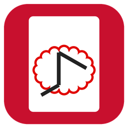
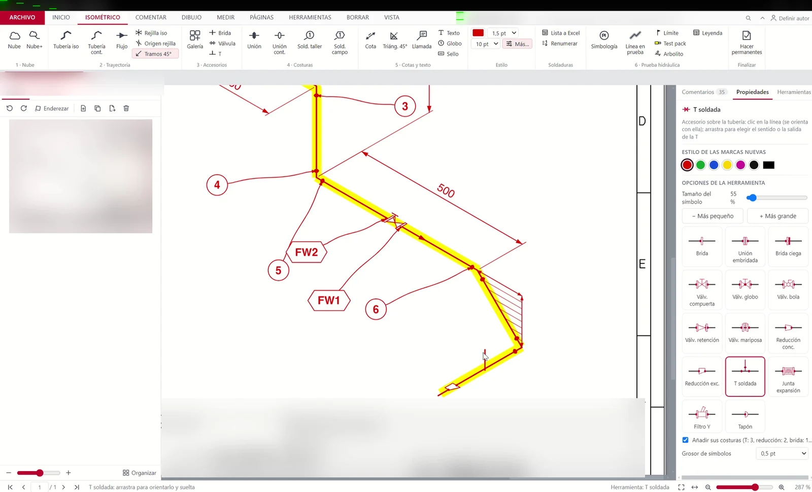
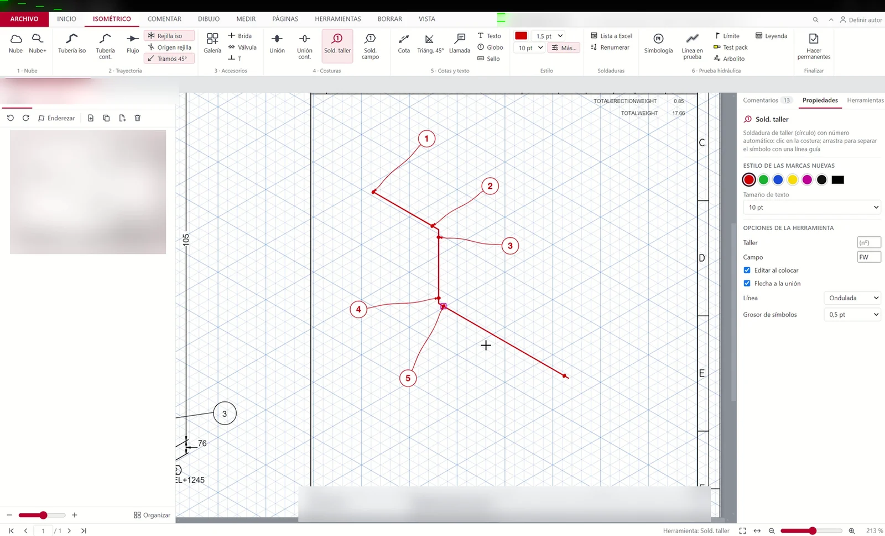
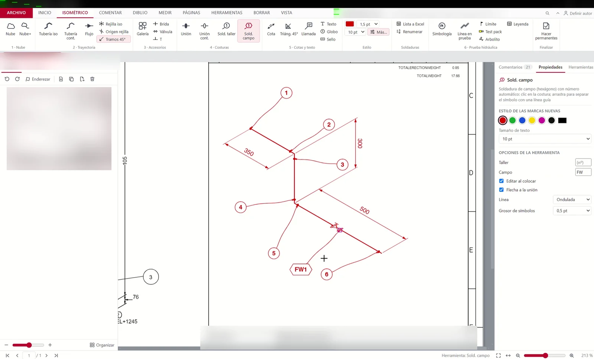

  

<h1 align="center">Aldrin PDF</h1>

<b>The free PDF editor built for piping isometrics.</b> 
Windows · Linux · Browser

  <a href="https://projectmechanicalpro.com/en/aldrin-pdf#download"><b>⬇ Download for free</b></a> ·
  <a href="https://projectmechanicalpro.com/en/aldrin-pdf#videos">▶ Watch the demos</a> ·
  <a href="https://github.com/martinboris-alt/aldrin-pdf/releases">Releases</a>

Aldrin PDF is a desktop PDF editor for reviewing and marking up piping isometric drawings. Everything you usually draw by hand on an isometric is one click away, on top of the original drawing.

## Features

| | |
|---|---|
| **Revision clouds** | Cloud any change, with comments, status (accepted, rejected, done) and author. |
| **Isometric pipes** | Every run snaps to the three iso axes. 45° offsets draw their hatched triangle automatically, in any position (Tab flips it). |
| **Automatic weld numbering** | Shop welds (circle) and field welds (FW hexagon) numbered as you click, with *Renumber* and export to Excel. |
| **Isometric dimensions** | Dimensions that follow the pipe axis, with the text aligned to the isometric plane. |
| **Valves & fittings** | Gate, globe, check, ball and butterfly valves, reducers, flanges, tees, caps, expansion joints… oriented to the run where you drop them. |
| **Hydrotest & test packs** | Highlight the test line in yellow, add test limits and vents, get the isometric ready for the dossier. |
| **Make permanent** | Burn your markups into the drawing so they look identical in any viewer – or keep them as standard, editable PDF annotations. |
| **Full PDF toolbox** | Crop (with auto-crop), split, merge, OCR, redact, measure, compare revisions and translate drawings. |

  
  

## Download

Aldrin PDF is **free**, including for commercial projects. Get it from the
[download page](https://projectmechanicalpro.com/en/aldrin-pdf#download)
(we ask for your name and email so we can tell you about updates) or from the
[latest release](https://github.com/martinboris-alt/aldrin-pdf/releases/latest).

| Platform | File |
|---|---|
| Windows 10/11 – installer | `AldrinPDF-Setup-<version>.exe` |
| Windows – portable (no install, USB) | `AldrinPDF-<version>-portable.exe` |
| Linux – any distro | `AldrinPDF-<version>-x86_64.AppImage` (`chmod +x` first) |
| Debian / Ubuntu / Mint | `AldrinPDF-<version>-amd64.deb` |
| Linux – archive | `AldrinPDF-<version>-x64.tar.gz` |
| Browser (no install) | `AldrinPDF.html` – open it in Chrome, Edge or Firefox |

Windows may show a SmartScreen warning because the app is new: click **More info → Run anyway**.

## Privacy

Aldrin PDF works offline. Your drawings and markups never leave your computer; markups are saved inside the PDF itself. The app only goes online if you choose to download the optional translation models or use an online translation service with your own key.

## Notes

- The interface is in Spanish. The demo videos and screenshots use a real isometric with the client data blurred.
- Feedback, bugs and feature requests: open an [issue](https://github.com/martinboris-alt/aldrin-pdf/issues) or write to martinboris@projectmechanicalpro.com.
- Need a custom tool for your piping project (test packs, Navisworks add-ons, as-built documentation)? See [MechanicalPro](https://projectmechanicalpro.com).

---

### En español

**Aldrin PDF** es un editor de PDF gratuito pensado para revisar isométricos de tubería: nubes de revisión, tuberías iso que se ajustan solas a los ejes, soldaduras de taller y de campo numeradas automáticamente, cotas, válvulas y accesorios, línea de prueba hidráulica y marcas que se pueden hacer permanentes. Funciona en Windows, Linux y en el navegador. Descárgalo gratis desde la [página de descarga](https://projectmechanicalpro.com/en/aldrin-pdf#download).

© 2026 Martin Boris Juica Becerra · MechanicalPro. Free to use; see [LICENSE](LICENSE).
